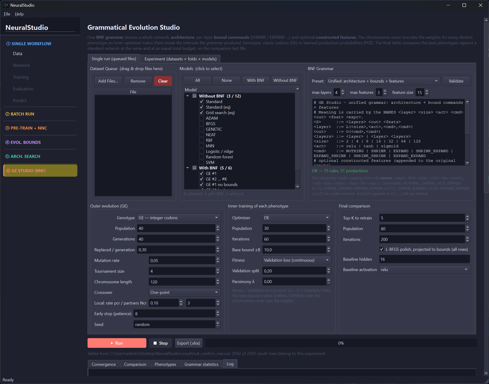

# NeuralStudio

**NeuralStudio** is an open-source, cross-platform no-code workbench for designing, training, evaluating, and deploying neural network models — built with **C++20** and **Qt6**.

> No Python. No browser. Load a dataset, configure a network, and train — or run complete experiments from the command line.

<p align="center">
  
</p><br>

---

## Platforms

| Linux | Windows | macOS |
|-------|---------|-------|
| ✓ | ✓ | ✓ |

**Build:** CMake ≥ 3.20 · Qt 6 (Core, Gui, Widgets, Charts, Svg) · C++20 compiler (GCC ≥ 11, Clang ≥ 14, MSVC 2022) · OpenMP (optional, parallel loss evaluation) · Eigen3 (optional)

---

## Six Modes

| # | Mode | What it does | Console command |
|---|------|--------------|-----------------|
| 1 | **Single Workflow** | Data → Network → Training → Evaluation → Prediction for one model, with K-fold cross-validation and export | `train`, `predict` |
| 2 | **Batch Run** | Datasets × optimisers × runs, with Holm-adjusted Wilcoxon tests and Friedman + Nemenyi analysis | `batch` |
| 3 | **Pre-Train + NNC** | A small pre-trained network is transferred neuron by neuron into the main network, which continues training from it | `pretrain` |
| 4 | **Evolutionary Bounds** | Per-parameter weight bounds are discovered by a penalised optimiser and the network is trained inside them | `bounds` |
| 5 | **Architecture Search** | An outer optimiser searches layers, sizes and activations; an inner optimiser trains every candidate | `archsearch` |
| 6 | **GE Studio** | Grammatical evolution with one BNF grammar for architecture, weight bounds and constructed features; experiment manager with ten reference models | `ge`, `ge experiment` |

The graphical application and the console program **`neuralstudio-cli`** call the same core code with the same defaults, so a command line computes exactly what the corresponding panel computes.

---

## Network Architectures

### Multilayer Perceptron (MLP)
- Arbitrary depth and width (hidden layers given as a comma-separated list, e.g. `64,32,16`)
- Per-layer activation: **Linear, ReLU, Sigmoid, Tanh**
- Global dropout regularisation (applied to all hidden layers; disabled at inference)
- Inputs min–max normalised with the training statistics; regression outputs standardised with the mean and standard deviation of the training targets
- Output layer and loss function derived automatically from the task type:
  - Regression → Linear + MSE
  - Binary Classification → Sigmoid (one output) + Binary Cross-Entropy
  - Multi-class Classification → Softmax (one output per class) + Categorical Cross-Entropy
- The cross-entropy losses are computed from the logits, so loss and gradient stay exact for saturated outputs

### Radial Basis Function Network (RBF)
- Kernels: **Gaussian, Multiquadric, Inverse Multiquadric**
- Centre placement: **k-means++** with configurable Lloyd iterations
- Width strategies: **Max Distance, Nearest Neighbour, Mean of 3 Nearest Neighbours**, with a width scale multiplier
- Output weights: ridge regression solved analytically via **Cholesky decomposition**
- Training is fully analytic — no gradient computation, completes in seconds

---

## Training Methods (25 total)

### Gradient-Based (6)
| Optimiser | Notes |
|-----------|-------|
| **Adam** | Adaptive moment estimation |
| **SGD** | Stochastic Gradient Descent |
| **AdamW** | Adam with decoupled weight decay |
| **RMSProp** | Root mean square propagation |
| **Nadam** | Nesterov + Adam |
| **AdaGrad** | Adaptive subgradient |

**Learning-rate schedules:** Constant · Step Decay · Exponential Decay

### Quasi-Newton & Classical Local Search (4)
`L-BFGS` · `BFGS` · `Conjugate Gradient (Polak–Ribière)` · `Levenberg–Marquardt`

### Single-Point Derivative-Free (2)
`Simulated Annealing` · `Nelder–Mead Simplex`

### Estimation-of-Distribution Algorithms (2)
`PBIL` · `UMDA`

### Population-Based Evolutionary & Swarm (11)
`GA` · `DE` · `PSO` · `CLPSO` · `ACOR` · `CMA-ES` · `LM-CMA-ES` · `jSO` · `mLSHADE-RL` · `SPARQ` · `TRIDENT-DE`

- **SPARQ** (successor of ARQ2): non-linear population-size reduction, success-history adaptation, eigen-coordinate crossover and a stagnation-triggered refinement of the best solution — *AppliedMath* 2026, 6, 138
- **TRIDENT-DE**: differential evolution with three mutation operators (best/1, current-to-best/1, pbest/1), self-adaptive parameters, greedy line refinement and adaptive micro-restarts — *Future Internet* 2025, 17, 488

All non-gradient methods search the weight vector inside a box: a configurable symmetric **weight bound** (Modes 1–3, 5) or per-parameter bounds (Modes 4 and 6).

---

## Data Ingestion

| Format | Detection |
|--------|-----------|
| `.csv` `.tsv` `.txt` | Auto-detects delimiter (`,` `;` `\t`) and header presence |
| `.train` `.test` `.data` | Neural Designer text format (first lines: number of inputs / number of samples) |

- **Drag-and-drop** supported
- **Companion test file auto-load**: `wine.train` → `wine.test`, `a.trn` → `a.tst`, `a_train.csv` → `a_test.csv`, `a-train.csv` → `a-test.csv`
- **The companion test file is never used for training, early stopping or model selection** — in Mode 1 it is shown as a monitoring curve, in Modes 2–6 it is scored after training
- **Automatic task detection**: two distinct target values → binary classification; at most twenty integer or half-integer values → multi-class classification; otherwise regression
- **Missing values**: missing inputs are replaced by the training mean of their column; rows with a missing target are removed and reported
- **Class-imbalance diagnostic** reported in-panel for classification tasks
- **Data preview**: first 100 rows in a scrollable table
- **Per-column statistics**: min, max, mean, standard deviation, median

---

## Mode 1 — Single Workflow

```
① Data  →  ② Network  →  ③ Training  →  ④ Evaluation  →  ⑤ Predict
```

Each stage is unlocked progressively as its prerequisites are satisfied.

| Panel | Key features |
|-------|-------------|
| **Data** | Load, preview, statistics, companion file auto-detection |
| **Network** | MLP / RBF architecture builder, automatic input/output sizing and task detection |
| **Training** | All 25 methods, LR scheduling, weight bound, early stopping (when no companion test file is loaded), K-fold CV, live loss/accuracy charts, CSV log |
| **Evaluation** | Accuracy, Precision, Recall, F1, Confusion Matrix (classification) · MAE, RMSE, R² (regression) · per-sample prediction table |
| **Predict** | Manual inference on individual samples, Load 1st Sample / Reset to Means shortcuts |

**K-fold cross-validation** (configurable K) trains K independent models on disjoint folds and reports mean ± std of loss and accuracy.

---

## Mode 2 — Batch Run

Automates training of **all selected optimiser × dataset combinations**.

- **Shared config**: one architecture and training configuration applies to all jobs
- **Optimiser matrix**: any subset of the 25 methods, with All / None / Gradient only / Evolutionary only shortcuts
- **Queue**: unlimited datasets via Add Files or drag-and-drop; independent runs per job
- **Live progress**: job counter, elapsed time, ETA, incremental results table
- **Results table**: one row per (dataset × optimiser) — task, N, inputs, classes, epochs, time(s), train/validation/test error %, MAE, RMSE, R²
- **Export XLSX**: full results table exported to a formatted spreadsheet

### Wilcoxon Signed-Rank Tab
- Pairwise two-tailed Wilcoxon signed-rank test for all optimiser pairs, **Holm-adjusted** over all pairs
- Metric selector: error %, MAE, RMSE, R² on the train / validation / test sets
- Task filter: All / Regression / Binary / Multi-class
- Repeated runs and folds of one dataset are averaged into one value per dataset
- Box plots with significance brackets; matrix of raw and Holm-adjusted p-values
- Export PNG at **300 DPI** and p-values as XLSX

### Friedman Test Tab
- Global Friedman χ² test across all optimisers and datasets
- Average-rank table (best → worst, best highlighted green, worst in red)
- **Nemenyi** post-hoc matrix: two optimisers differ when the gap between their average ranks exceeds the critical difference
- Export PNG at **300 DPI**

---

## Mode 3 — Pre-Train + NNC

Adapts the pre-training phase of *Tsoulos et al., Symmetry 2025, 17, 1567* to networks of fixed architecture.

- **Phase 1**: a network with one hidden layer of **Iw** nodes (default 10, same activation as the main network) is trained
- **Transfer**: its weights are copied neuron by neuron into the first hidden layer of the main network; with one hidden layer the main network starts as exactly the pre-trained function
- **Phase 2**: the main network is trained from the transferred weights, in a box focused around them
- **Phase 3** (optional): a second optimiser continues the training, e.g. a local method after a global one
- **Baseline**: the same network without pre-training, with an **equal total budget** of evaluations (default)
- **Never worse**: a phase that increases the training or validation error is not carried forward
- 15 optimisers per phase (GA, DE, PSO, CMA-ES, jSO, LM-CMA-ES, ACOR, CLPSO, mLSHADE-RL, SPARQ, TRIDENT-DE, SA, L-BFGS, BFGS, Nelder–Mead)
- Tabs: Loss per iteration, Evaluation, Comparison, Bar chart; N independent runs (mean ± std); XLSX / PNG export
- The final network is passed to the Evaluation and Prediction panels of Mode 1

---

## Mode 4 — Evolutionary Bounds

Implements the three-phase bound construction of *Tsoulos et al., Foundations 2025, 5, 11* and *Tsoulos & Charilogis, BDCC 2025, 9, 5*.

- **Phase 1 — Bounds discovery**: training inside ±W₀ with the penalised objective E·(1 + λB²), where B is the fraction of hidden-layer weights with |w| > a; every parameter then gets the interval ±min(max(f·|g*ᵢ|, 0.1·W₀), W₀) (defaults: GA 500 × 200, λ = 2, a = 5, f = 3, W₀ = 10)
- **Phase 2 — Training in bounds**: an optimiser trains inside the Phase-1 intervals and the intervals are narrowed around the solution, **or** the *GE Grammar Bounds* option scales each interval with the bound commands of the BNF grammar (NOTHING, SHRINK, EXPAND, …), **or** the phase is skipped
- **Phase 3 — Final training** (optional): a third optimiser inside the final intervals, with an optional bounded **L-BFGS polish**
- **Baseline** at equal total budget and the same **never-worse** safeguards as Mode 3
- Tabs: Loss per iteration, **Parameter bounds** (lower / upper bound of every parameter), Evaluation, Comparison; N independent runs; XLSX / PNG export
- The final network is passed to Mode 1

---

## Mode 5 — Architecture Search

- **Search space**: number of hidden layers (default 1–4), candidate sizes (default 4, 8, 16, 32, 64, 128; presets XS–XL), activations (ReLU, Tanh, Sigmoid, optionally Linear) — every layer has its own size and activation
- **Outer optimiser** (default GA, population 30 × 50 generations ≤ 1500 architecture evaluations): any of the 11 population-based methods
- **Inner training** of every candidate (default DE 50 × 50, weights in ±10) followed by a bounded **L-BFGS polish** (default 400 evaluations), so large networks are not compared half-trained
- **Fitness**: validation error; the companion test file is reported but never used by the search
- **Cache**: an architecture that reappears is never trained twice
- **Top-K** table (rank, architecture, validation / test / training error, loss, parameters); ties broken in favour of fewer parameters
- N independent runs with a **Comparison** tab (mean ± std per architecture); XLSX export
- **Apply to Mode 1**: loads the dataset and the best architecture into the Network panel

---

## Mode 6 — GE Studio

One **BNF grammar** derives a whole network: **architecture**, per-layer **bound commands** and optional **constructed features**. The chromosome never encodes the weights: for every distinct phenotype an inner optimiser trains them inside the intervals the grammar produced.

### Single run page
- **Grammar**: editor with validation and presets (unified: architecture + bounds + features, architecture + bounds, architecture only, custom); meaning is read from rule names (`<layer>`, `<out>`, `<feat>`); `@VARS@` expands to `x1 | … | xN`
- **Bound commands** NOTHING, SHRINK (×0.5), EXPAND (×1.5), SHRINK_EXPAND / EXPAND_SHRINK (×0.75), SHRINK_SHRINK (×0.25), EXPAND_EXPAND (×2.25) scale the base interval of each layer: layer scale K·√(6/(fan-in + fan-out)) (default, K = 3) or an absolute ±B
- **Constructed features**: expressions over the inputs (+, −, ×, /, log, sqrt, abs, tanh, exp, sin), constant-folded, size-limited, clipped to the training percentiles
- **Genotypes**: classic GE (integer codons, one-point crossover, optional **Local Crossover**) or **PGE** (learned production probabilities, optionally carried to the next dataset)
- **Inner training**: 12 optimisers (default DE 30 × 60) + bounded L-BFGS polish; fitness = validation loss (or validation error %) × parsimony factor
- Identical phenotypes are cached; a reappearing phenotype **resumes training** from its stored weights; the best phenotypes are refined and re-ranked after the search; early stop by patience
- **Final comparison** on the companion test file: Standard network, Standard at equal total budget, grid search over 16 classic architectures, GE #1 … #K, ablation without bound commands, equal-budget retraining
- **Ten reference models**: ADAM, BFGS, GENETIC (MLPs with 10 sigmoid nodes), NEAT, RBF, kNN, logistic / ridge regression, random forest, SVM, and GNN (the grammar-guided method of BDCC 2025)
- Tabs: Convergence, Comparison, Phenotypes, Grammar statistics, Log; XLSX export

### Experiment page (datasets × folds × models)
- Experiments stored as **JSON** files: data folder, datasets per task, folds, seeds, grammar configurations, models, options
- New / Open / Edit / Save; reopen earlier results from their `<prefix>_raw.csv`
- Equivalent **command line** shown and editable (identical to `neuralstudio-cli ge experiment`)
- Optional **fixed total budget T** per run, so that every model is compared at equal cost
- **Resumable**: finished runs are skipped; a changed experiment computes only what is missing
- **Overall tables** (Classification / Regression): mean test error over folds per dataset and model, average error, Friedman rank, wins / ties / losses, Wilcoxon p (datasets as units), scale-free relative differences with Holm adjustment, Friedman p and Nemenyi critical difference
- **Hypotheses** tab: pre-declared comparisons with Holm adjustment; development datasets are excluded

---

## Console Program — `neuralstudio-cli`

Runs every mode without the graphical interface (Qt Core only), e.g. over SSH or on a server.

```
neuralstudio-cli <command> [options]
neuralstudio-cli <command> --help
```

| Command | Mode |
|---------|------|
| `train` | 1 — train one MLP or RBF network, evaluate, K-fold CV, save / export, predict |
| `predict` | apply a saved `.nsmodel` network to a data file |
| `batch` | 2 — datasets × optimisers × runs with Wilcoxon / Friedman tests |
| `pretrain` | 3 — Pre-Train + NNC |
| `bounds` | 4 — Evolutionary Bounds |
| `archsearch` | 5 — Architecture Search |
| `ge`, `ge experiment` | 6 — GE Studio single run / complete experiment |
| `list` | optimisers, grammar configurations, models |

```bash
neuralstudio-cli train --data wine.train --hidden 16 --act tanh --optimizer adam --epochs 500 \
                       --out wine.xlsx --save-model wine.nsmodel --export-onnx wine.onnx
neuralstudio-cli batch --data sample_data/selected --optimizers adam,de,pso --runs 5 --out batch.xlsx
neuralstudio-cli bounds --data pima.train --opt2 de --runs 10 --out bounds.xlsx
neuralstudio-cli ge experiment --experiment experiments/my_experiment.json
```

- Results go to standard output, progress to standard error; `--quiet`, `--verbose`
- Ctrl+C stops after the current step and reports what was completed
- Exit codes: 0 success, 1 a run failed, 2 invalid command line, 130 interrupted

Full reference: [`docs/CLI.md`](docs/CLI.md)

---

## Export and Files

| Format | Description |
|--------|-------------|
| **C++ header** (`.h`) | Self-contained, zero-dependency header embedding all weights and normalisation parameters. `#include` and call `predict()` — no external libraries required at inference time |
| **ONNX** (`.onnx`) | Standard model format for use in other environments |
| **Model file** (`.nsmodel`) | Save and reload trained networks |
| **Project file** (`.nsproj`) | Dataset and architecture of Mode 1 and the dataset queues of Modes 2–6 |
| **XLSX results** | Result tables of every mode (written without external libraries) |
| **CSV training log** | Per-epoch loss, accuracy, and learning rate from the Training panel |
| **PNG figures** | Plots at 300 DPI |

---

## Windows installer

> **Windows installer available:** download and run **NeuralStudio.exe** (graphical application, console program and Qt runtime — no Qt or compiler needed) from:
>
> **[NeuralStudio.exe (Windows Installer)](https://www.dit.uoi.gr/files/NeuralStudio.zip)**

---

## Build

The build produces the graphical application `neuralstudio` and the console program `neuralstudio-cli`.

| CMake option | Default | Builds |
|--------------|---------|--------|
| `NS_BUILD_CLI` | `ON` | the console program `neuralstudio-cli` |
| `NS_BUILD_TESTS` | `OFF` | headless tests and the stand-alone experiment tool `ge_batch` |

### Windows (PowerShell)

```powershell
# 1. Clean previous build (optional)
Remove-Item -Recurse -Force build -ErrorAction SilentlyContinue

# 2. Configure
cmake -S . -B build `
   "-DCMAKE_PROJECT_INCLUDE:FILEPATH=$PWD/cmake/neuralstudio.cmake" `
   "-DCMAKE_PREFIX_PATH=C:\Qt\6.10.1\msvc2022_64"

# 3. Build
cmake --build build --config Release

# 4. Deploy Qt runtime dependencies
& "C:\Qt\6.10.1\msvc2022_64\bin\windeployqt.exe" `
   --release --no-translations --compiler-runtime `
   ".\build\Release\neuralstudio.exe"

# 5. Run
.\build\Release\neuralstudio.exe               # graphical application
.\build\Release\neuralstudio-cli.exe --help    # console program
```

> Adjust `C:\Qt\6.10.1\msvc2022_64` to match your Qt installation path.

---

### Linux
```bash
# 1. Clean previous build (optional)
rm -rf build

# 2. Configure
cmake -S . -B build -DCMAKE_BUILD_TYPE=Release \
   "-DCMAKE_PROJECT_INCLUDE:FILEPATH=$PWD/cmake/neuralstudio.cmake" \
   "-DCMAKE_PREFIX_PATH=/path/to/Qt/6.10.1/gcc_64"

# 3. Build
cmake --build build --parallel $(nproc)

# 4. Run
./build/neuralstudio               # graphical application
./build/neuralstudio-cli --help    # console program
```

> With the Qt 6 packages of your distribution (e.g. `qt6-base-dev`, `qt6-charts-dev`, `qt6-svg-dev` on Ubuntu) the Qt path can be omitted. No deployment step is needed for local use; for distribution, use
> [linuxdeployqt](https://github.com/probonopd/linuxdeployqt) or AppImage tooling.

---

### macOS
```bash
# 1. Clean previous build (optional)
rm -rf build

# 2. Configure
cmake -S . -B build -DCMAKE_BUILD_TYPE=Release \
   "-DCMAKE_PROJECT_INCLUDE:FILEPATH=$PWD/cmake/neuralstudio.cmake" \
   "-DCMAKE_PREFIX_PATH=/path/to/Qt/6.10.1/macos"

# 3. Build
cmake --build build --parallel $(sysctl -n hw.logicalcpu)

# 4. Deploy Qt runtime dependencies (required for distribution)
/path/to/Qt/6.10.1/macos/bin/macdeployqt build/neuralstudio.app

# 5. Run
open build/neuralstudio.app
# or directly:
./build/neuralstudio.app/Contents/MacOS/neuralstudio
./build/neuralstudio-cli --help    # console program
```

> Adjust `/path/to/Qt/6.10.1/macos` to match your Qt installation path.
